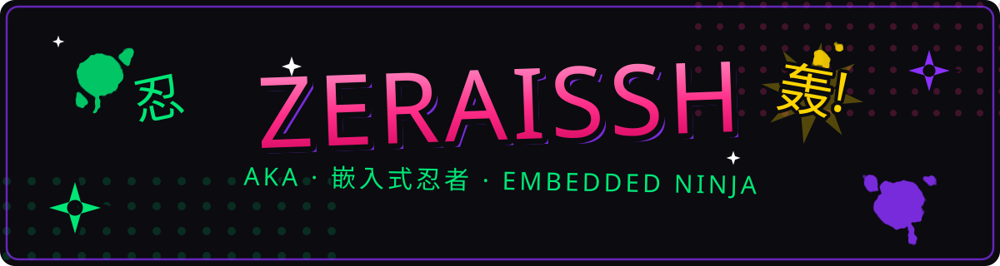

  

  

## 🥷「忍法帖 · 关于我」

- 🎤 Yo，我是 **Zeraissh**，修行中的**嵌入式忍者**
- ⚙️ 忍道两界：**上位机** ↔ **下位机**，主战场 **STM32**
- 🗡️ 当前炼狱：`stm32-gdb-mcp` / `Coding_WorkFlow`
- 📜 忍法信条：**代码即忍法，调试即修行**

🎴 忍 · 奥义（点我展开彩蛋）

> 「星空之下，Bug 遍布！在庄严示波器的见证下，吟诵辞世句吧——三声蜂鸣——胜负已分。」
>
> —— 改编自 乱破（《崩坏：星穹铁道》）

## 🎯「通缉令 · 项目展示」

  
  

## 🗡️「忍具库 · 技能」

  

  
  
  
  

## 📡「联络忍术 · 找到我」

  
  
  

  
   
  

