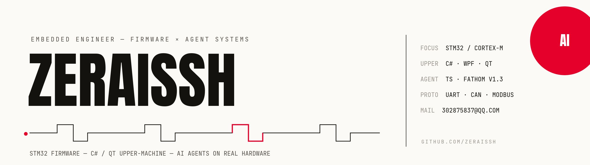

  

 

## 关于我

- **嵌入式工程师**，主战场 **STM32 / ARM Cortex-M**，上位机 ↔ 下位机全栈
- 上位机开发：**C# / WPF / Qt**，熟悉串口 · CAN · Modbus 工业协议
- 热衷于把 **AI Agent** 带进嵌入式开发——让 AI 直接调试真实硬件
- 在 B 站记录开发日常，欢迎来逛

## 代表作

| 项目 | 简介 | 技术 |
| --- | --- | --- |
| [stm32-gdb-mcp](https://github.com/Zeraissh/stm32-gdb-mcp) | MCP server：让 AI Agent 在真实硬件上调试 STM32 固件（HardFault 分诊、FreeRTOS、SWO/RTT） |   |
| [Fathom_Harness](https://github.com/Zeraissh/Fathom_Harness) | FATHOM：从零手写的智能体框架（TypeScript），Web / CLI / 桌面三端，独立 verifier 三值裁决 |   |

  
  

## 技术栈

**嵌入式 / 固件**

**上位机 / 应用**

**工具链**

## GitHub 统计

## 联系我

